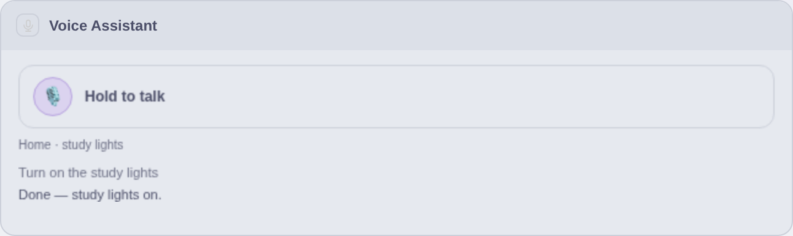

# Voice Assistant



Hold-to-talk voice commands that run locally. The assistant starts blank: you
describe a capability to your agent, the agent adds a route for it, and from
then on the assistant can do that thing. Speech-to-text, routing, and execution
all happen on your machine; nothing is sent to a cloud service unless you
configure an optional LLM or integration yourself.

## Routes come from you

A fresh install has no routes. It records, transcribes, and tells you it has no
action for what it heard.

Open **Settings → Modules → Voice Assistant**, describe the capability in plain
language — "when I say *focus mode*, turn on the office lights and start a
timer" or "open my notes app" — and ask the agent. The agent edits
`data/config.toml`, and the new route appears in the Settings catalog right
away. There is no engine change and no restart. You can review its phrases and
action, disable it, or delete it from Settings.

Routes can call Home Assistant services, run shell commands, open apps, ask a
local LLM, delegate to OpenCode, or group actions into modes. Everything is
optional: use only what exists on your machine. Desktop-specific extras, such
as workspace switching, appear only when the tools for them are present.

## Home Assistant Assist

If you use Home Assistant, this module can power Assist. The Home Assistant
module installs its Jarvis component and points an Assist conversation agent
and Whisper STT pipeline at this engine, so an HA voice satellite — phone,
ESPHome device, or speaker — can use the same routes you built here with local
speech recognition.

The engine serves `POST /api/conversation` and `POST /api/stt` on
`127.0.0.1:8790` by default, protected by a bearer token shared with the Home
Assistant module. Settings → Modules → Voice Assistant has Start, Restart, and
Stop controls for it; no separate system service is needed. If Home Assistant
runs on another machine, point the Home Assistant module at this URL.

## Setup

```bash
orqella module install https://github.com/orqella/orqella-voice-assistant
```

- The overview card uses the trusted shell microphone bridge. Hold to talk.
  The module is overview-only; there is no standalone page tab.
- Python 3.11+ is required. The Settings setup button creates a managed virtual
  environment, installs `sounddevice` and `psutil`, and downloads the Whisper
  model (`small.en` by default; set `stt.model` in `data/config.toml` to change
  it).
- Linux records through PipeWire `pw-record`; macOS and Windows record through
  `sounddevice`. macOS needs microphone access, plus Accessibility for typing
  into the focused app. Linux typing uses `wtype` when present and falls back
  to clipboard tools.
- Notifications use the native tool for each platform: `notify-send`,
  `osascript`, or PowerShell.

## Data and security

Runtime data lives under the installed module's `data/` directory:
`config.toml`, `models/`, `.venv/`, and `route_state.json`. `data/config.toml`
is mode 0600 because it can hold the API token and token commands. The shared
`voice-engine.token` file is kept in sync and is also 0600.

The sidecar is intentionally unsandboxed (`sandbox = false`) because it needs
the desktop session, audio devices, keyring, and local model files. It records
only after the `media.record` permission is granted. Treat it as a trusted
local application.

`[api].host` defaults to `127.0.0.1`. Setting it to `0.0.0.0` exposes the
Assist API beyond this machine; the token is still required, but prefer a
loopback bind or a firewall. Home Assistant and LLM clients send tokens over
plain HTTP when their URLs use `http://`; use HTTPS for anything that is not
loopback.
